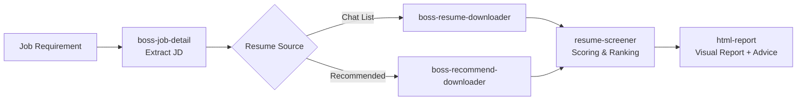

# BOSS Zhipin · HR Agent Skill Pack

> [!NOTE]
> Composed of **7 AI Agent Skills**, implemented based on [boss-agent-cli](https://github.com/can4hou6joeng4/boss-agent-cli) to achieve **full-process automation** for BOSS Zhipin resume screening: from job posting to visual reports, all in one click.

<p align="center">
  
  
  
  
</p>

---

## 📑 Table of Contents

- [✨ What is this?](#-what-is-this)
- [🎯 Core Capabilities](#-core-capabilities)
- [🧩 Skill Overview & Workflow](#-skill-overview--workflow)
- [🚀 Quick Start](#-quick-start)
- [🧠 Scoring System](#-scoring-system)
- [🛡️ Safety & Risk Control](#️-safety--risk-control)
- [📂 Project Structure](#-project-structure)
- [📤 Output Files](#-output-files)
- [⚙️ Environment Variables](#️-environment-variables)
- [🔗 Related Links](#-related-links)

---

## ✨ What is this?

You provide the job position; leave the rest to AI:

```
   Job Position    →   AI Auto-extracts JD   →   Auto-downloads Resumes   →   Auto-scoring & Ranking   →   Visual Report + Communication Advice
(One-sentence req)      (boss-job-detail)      (recommend / chat list)     (resume-screener)           (html-report)
```

**In a nutshell:** AI helps you screen dozens of resumes in minutes to find the most compatible candidates and tells you exactly what to discuss with each person.

---

## 🎯 Core Capabilities

| Capability | Description |
|:----:|------|
| 🔍 **JD Extraction** | One-click capture of job details, requirements, and core skill points |
| 📥 **Resume Acquisition** | Supports "Chat List" and "Recommended Talents" paths, using real browser fingerprints for low risk |
| 🧮 **Intelligent Scoring** | 5-dimension weighted scoring + educational background tier calibration, with hard threshold filtering |
| 📊 **Visual Reporting** | Ranking tables + 5D radar charts + personalized communication suggestions, generated as HTML |
| 🧪 **Testable** | Core algorithms are covered by unit tests in `tests/` |

> **🚪 `boss-hr-auto` is the sole entry point**, and other Skills are its sub-steps. Always start from `boss-hr-auto`.

---

## 🧩 Skill Overview & Workflow

| # | Skill | Role | Purpose |
|:-:|------|:----:|------|
| 0 | **boss-hr-auto** | 🚪 Entry | Orchestrates the full workflow (sole entry point) |
| 1 | boss-agent-cli | 📖 Reference | BOSS CLI command manual (referenced by other Skills) |
| 2 | boss-job-detail | Step 1 | Extracts Job JD |
| 3A | boss-resume-downloader | Step 2A | Downloads resumes from the chat list |
| 3B | **boss-recommend-downloader** | Step 2B | Obtains full resumes from the recommended talents page |
| 4 | resume-screener | Step 3 | Hard threshold filtering + weighted scoring + education tiering |
| 5 | html-report | Step 4 | Generates visual HTML reports + communication suggestions |

### Workflow Diagram



---

## 🚀 Quick Start

> **No binary compilation required.** Everything is installed via package managers; use your system's built-in browser.

### Prerequisites

| Dependency | Description | Installation |
|------|------|---------|
| Python 3.10+ | Run scripts | [python.org](https://python.org) |
| [boss-agent-cli](https://github.com/can4hou6joeng4/boss-agent-cli) | BOSS Zhipin CLI | `uv tool install boss-agent-cli` |
| patchright | CDP Client (**No browser included, no Chromium download**) | `pip install patchright` |
| Chrome / Edge | System default | Skip if already installed |

### 1. Installation

```bash
# boss CLI
uv tool install boss-agent-cli

# Python dependencies
pip install patchright
```

### 2. Start CDP Browser

**Windows (Edge recommended):**

```powershell
Start-Process "msedge" -ArgumentList `
  "--remote-debugging-port=9222", `
  "--user-data-dir=$env:USERPROFILE\.workbuddy\chrome-profiles\boss-cdp"
```

**macOS / Linux：**

```bash
google-chrome \
  --remote-debugging-port=9222 \
  --user-data-dir="$HOME/.workbuddy/chrome-profiles/boss-cdp"
```

### 3. Login

```bash
# Scan QR code in browser → Extract to CLI
boss login --cdp --timeout 30

# Verification (Both steps must pass)
boss --role recruiter me
boss --role recruiter --platform zhipin --cdp-url http://localhost:9222 hr jobs list
```

### 4. Disable Low-Risk Mode (Required for resume download)

```bash
# Create/edit config file
cat > ~/.boss-agent/config.json << 'EOF'
{
  "low_risk_mode": false,
  "platform": "zhipin",
  "role": "recruiter"
}
EOF
```

> [!WARNING]
> **Must be disabled**: `low_risk_mode` is enabled by default, which blocks resume acquisition.

### 5. Usage

Call within the agent:

```
@skill://boss-hr-auto Chassis Engineer
```

Or simply say:

```
Help me screen resumes for a Chassis Engineer
```

---

## 🧠 Scoring System

### Current Weights (5D Weighted Sum)

> [!NOTE]
> Currently, `resume-screener/scripts/score_resumes.py` uses a **single set of 5D weights** (totaling 100%). To differentiate by job type, please extend the `WEIGHTS` constant instead of hard-coding multiple sets.

| Dimension | Weight | Scoring Method |
|------|:----:|---------|
| Education (edu) | **25%** | `validate_score()` uses `school_tier.py` to **force override** LLM's edu score; Master's degree +8% |
| Experience (exp) | **25%** | Relevant years of experience + business alignment |
| Skills (skill) | **25%** | JD skill coverage rate |
| Projects (proj) | **15%** | Project complexity + relevance |
| Major (major) | **10%** | Matching=100%, Relevant=80%, Unrelated=30-60% |

### Total Score & Tiers

- `weighted[d] = round(dims[d] * WEIGHTS[d], 2)`
- `total = round(sum(weighted.values()), 1)`
- Tier Thresholds: `>= 70` $\rightarrow$ **Recommended**; `>= 60` $\rightarrow$ **Pending**; otherwise $\rightarrow$ **Not Recommended**
- All logic is in `resume-screener/scripts/score_resumes.py`, covered by unit tests in `tests/`: `python -m pytest tests/`

### Education Tier Table

| Tier | Score | Examples |
|------|:----:|------|
| C9 | 100 | Tsinghua, Peking, Fudan, SJTU, etc. |
| 985 | 92 | Other 985 universities |
| 211 | 85 | Other 211 universities |
| Double First-Class | 77 | Double First-Class construction universities |
| Tier 1 Public | 71 | Provincial key Tier 1 universities |
| Tier 2 Public | 62 | Ordinary public Tier 2 universities |
| Private Bachelor | 53 | Private colleges, independent colleges |

> [!IMPORTANT]
> Education scoring must strictly follow the tier table; **do not assign the same score to everyone**.

### Action Advice Rules

Output format: `📊 Ranking Table (including 5D weighted scores) + 📋 Scoring basis per person + 🎯 Personalized action advice`

- **Recommended for Interview**: Must include "Candidate Background" + "Communication Direction" for each person.
- **Pending Confirmation**: Must include "Strengths" + "Questions to Confirm" for each person.
- ❌ Prohibited: Using identical communication directions for all candidates.

---

## 🛡️ Safety & Risk Control

### Recommended Talent Download

| Practice | Description |
|:----:|------|
| ✅ Real Browser TLS Fingerprint | Fetch via patchright within Edge; server cannot distinguish from a real human |
| ✅ Scrolling Delay 3-6s Random | Simulates human browsing |
| ✅ Resume Retrieval 5-15s Random | Simulates human reading |
| ✅ Run during working hours | Suggested: 9:00 - 18:00 |
| ✅ Max 50 people per batch | Split into batches if exceeding 50 |

### General Rules

- ❌ No automated messaging (CLI permissions are insufficient)
- ✅ Random delays between batch operations
- ✅ Incremental synchronization (automatically skips already downloaded resumes)
- ✅ Cookies extracted preferentially from local browser

### Risk Detection Dimensions

| Dimension | Safe Practice | Dangerous Practice |
|------|---------|---------|
| Request Frequency | 5-20s Random | Fixed intervals or high frequency |
| Operation Time | Working hours | Late night/Early morning |
| Behavior Pattern | Scrolling and pausing | Pure API without page interaction |
| Volume Control | Batch processing | Hundreds at once |

---

## 📂 Project Structure

```
boss-hr-agent-toolkit/
├── README.md                          # This file
├── FILE_MANAGEMENT.md                 # File management specifications
├── .gitignore
│
├── boss-hr-auto/                      # 🚪 Full process orchestration (sole entry)
│   └── SKILL.md
│
├── boss-agent-cli/                    # 📖 CLI command reference
│   ├── SKILL.md
│   └── scripts/
│       ├── boss_login_guard.py        # Login guard
│       └── patch_stoken.py            # stoken patch
│
├── boss-job-detail/                   # Step 1: JD Extraction
│   ├── SKILL.md
│   └── scripts/boss_jd.py
│
├── boss-resume-downloader/            # Step 2A: Chat list resume download
│   ├── SKILL.md
│   ├── scripts/sync_boss_resumes.py
│   └── references/
│
├── boss-recommend-downloader/         # Step 2B: Recommended talent resume download
│   ├── SKILL.md
│   └── scripts/
│       ├── recommend_list.py          # Get candidate list
│       ├── recommend_download.py      # Batch fetch resumes (patchright + fetch)
│       └── run_all.py                 # One-click run (list + download)
│
├── resume-screener/                   # Step 3: Scoring System
│   ├── SKILL.md
│   ├── references/
│   └── scripts/
│       ├── score_resumes.py           # Weighted scoring + tier calibration
│       └── school_tier.py             # Education tier table
│
├── html-report/                       # Step 4: Report Generation
│   ├── SKILL.md
│   ├── scripts/generate_html_report.py
│   └── templates/report.html
│
├── shared/                            # Shared Tools
│   ├── output_manager.py              # Unified file path management
│   ├── fix_encoding.py                # Encoding fix
│   └── human_interaction.py           # Human interaction fallback
│
└── tests/                             # Unit Tests
    ├── conftest.py
    ├── test_school_tier.py
    └── test_score_resumes.py
```

---

## 📤 Output Files

All outputs are automatically saved to:

```
~/Desktop/boss-hr-output/
└── <Job_Name>/
    ├── <Job_Name>_Unified_Solution.html  # Final HTML report
    └── process/                       # Process files (for auditing)
        ├── job_detail.json            # JD data
        ├── recommend_geek_ids.json    # Accumulated candidate IDs
        ├── test_resumes.json          # Accumulated all resumes
        └── screening_results.json     # Scoring results
```

> [!TIP]
> - Do not scatter files on the desktop; HTML reports go in the job folder root, intermediate data goes in `process/`.
> - Delete temporary Python scripts after the task ends.
> - Reuse existing Python scripts within skills; do not reinvent the wheel.
>
> See [FILE_MANAGEMENT.md](FILE_MANAGEMENT.md) for details.

---

## ⚙️ Environment Variables

| Variable | Description | Default Value |
|------|------|--------|
| `BOSS_BIN` | Path to boss CLI | `boss` |
| `CDP_URL` | Browser CDP debug address | `http://localhost:9222` |
| `PYTHONHOME` | **Must be cleared** | `""` |
| `PYTHONIOENCODING` | Avoid CLI encoding issues | `utf-8` |

---

## 🔗 Related Links

- [boss-agent-cli](https://github.com/can4hou6joeng4/boss-agent-cli) — Underlying CLI tool
- [patchright](https://github.com/Kaliiiiiiiiii-Vinyzu/patchright) — Playwright fork (CDP browser control)

---

## 📄 License

[MIT](https://opensource.org/licenses/MIT)
